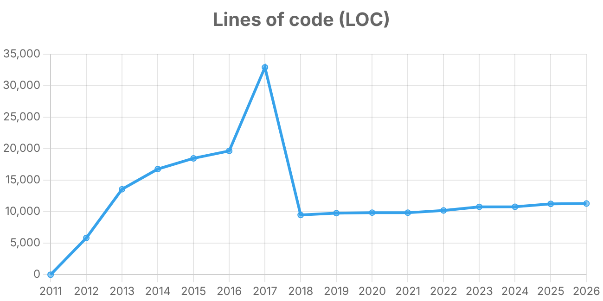

# Explorando evolução de código

Neste exercício, iremos explorar a evolução de código em sistemas reais.

Iremos utilizar a ferramenta [GitEvo](https://github.com/andrehora/gitevo).
Essa ferramenta analisa a evolução de código em repositórios Git nas linguagens Python, JavaScript, TypeScript e Java, e gera relatórios `HTML` como [este](https://andrehora.github.io/gitevo-examples/python/pandas.html).

Mais exemplos de relatórios podem ser podem ser encontrados em https://github.com/andrehora/gitevo-examples.

# Passo 1: Selecionar repositório a ser analisado

Selecione um repositório relevante na linguagem de sua preferência (Python, JavaScript, TypeScript ou Java).
Você pode encontrar projetos interessantes nos links abaixo:

- Python: https://github.com/topics/python?l=python
- JavaScript: https://github.com/topics/javascript?l=javascript
- TypeScript: https://github.com/topics/typescript?l=typescript
- Java: https://github.com/topics/java?l=java

# Passo 2: Instalar e rodar a ferramenta GitEvo

> [!NOTE]
> Antes de instalar a ferramenta, é recomendado criar e ativar um [ambiente virtual Python](https://packaging.python.org/en/latest/guides/installing-using-pip-and-virtual-environments/#create-and-use-virtual-environments).

Instale a ferramenta [GitEvo](https://github.com/andrehora/gitevo) com o comando:

```
$ pip install gitevo
```

Execute a ferramenta no repositório selecionado utilizando o comando abaixo (ajuste conforme a linguagem do repositório).
Substitua `<git_url>` pela URL do repositório que será analisado:

```shell
# Python
$ gitevo -r python <git_url>

# JavaScript
$ gitevo -r javascript <git_url>

# TypeScript
$ gitevo -r typescript <git_url>

# Java
$ gitevo -r java <git_url>
```

Por exemplo, para analisar o projeto Flask escrito em Python:

```
$ gitevo -r python https://github.com/pallets/flask
```

> [!NOTE]
> Essa etapa pode demorar alguns minutos pois o projeto será clonado e analisado localmente.

# Passo 3: Explorar o relatório de evolução de código

Após executar a ferramenta [GitEvo](https://github.com/andrehora/gitevo), é gerado um relatório `HTML` contendo diversos gráficos sobre a evolução do código.

Abra o relatório `HTML` e observe com atenção os gráficos.

# Passo 4: Explicar um gráfico de evolução de código

Selecione um dos gráficos de evolução e explique-o com suas palavras.
Por exemplo, você pode:

- Detalhar a evolução ao longo do tempo
- Detalhar se as curvas estão de acordo com boas práticas
- Explicar grandes alterações nas curvas
- Explorar a documentação do repositório em busca de explicações para grandes alterações
- etc.

Seja criativo!

# Instruções para o exercício

1. Crie um `fork` deste repositório (mais informações sobre forks [aqui](https://docs.github.com/pt/pull-requests/collaborating-with-pull-requests/working-with-forks/fork-a-repo)).
2. Adicione o relatório `HTML` no seu fork.
3. No Moodle, submeta apenas a URL do seu `fork`.

Responda às questões abaixo diretamente neste arquivo `README.md` do seu fork:

1. Repositório selecionado: https://github.com/psf/requests

   Relatório gerado: [`report_requests.html`](report_requests.html) (dados em [`report_requests.csv`](report_requests.csv)), produzido com:

   ```
   $ gitevo -r python -f 2011 https://github.com/psf/requests
   ```

   > Usei `-f 2011` para cobrir todo o histórico do projeto (o primeiro commit é de fevereiro de 2011). Sem essa opção, o GitEvo analisa só os últimos 5 anos.

2. Gráfico selecionado: **Lines of code (LOC)**

   

3. Explicação:

   O gráfico mostra o total de linhas de código Python do repositório, medido em um commit por ano (no início de cada ano). A curva tem três fases bem diferentes.

   **2011 a 2016: crescimento contínuo.** O ponto de 2011 é zero porque corresponde ao primeiro commit do projeto (13/02/2011), que ainda não tinha arquivos `.py`. Depois disso o código cresce rápido: cerca de 5,8 mil linhas em 2012, 13,6 mil em 2013 e 19,6 mil em 2016. O número de arquivos `.py` sobe junto (34 → 84). Grande parte desse crescimento, porém, **não era código do requests**: o projeto carregava cópias de outras bibliotecas dentro da pasta `requests/packages/` (prática chamada *vendoring*), principalmente o `urllib3` e o `chardet`.

   **2017: o pico.** No início de 2017 o LOC salta para quase 32,9 mil linhas e 106 arquivos. A causa é a inclusão de mais uma biblioteca embutida, o `idna` (commit `3c680cc1`, "Vendor idna v2.1", de outubro de 2016). Só o arquivo `requests/packages/idna/uts46data.py` tem mais de 7 mil linhas, quase todas tuplas de uma tabela Unicode. Isso aparece também no gráfico de `tuple` do relatório, que pula de 439 para 9.037 no mesmo ano. Nesse momento, cerca de 24 mil linhas estavam em `requests/packages/`, ou seja, aproximadamente três quartos do código Python do repositório eram de terceiros.

   **2018 em diante: queda brusca e estabilidade.** De 2017 para 2018 o LOC cai para cerca de 9,5 mil linhas e o número de arquivos cai de 106 para 35. Essa queda não significa que funcionalidades foram removidas. O `HISTORY.md` do projeto registra, na versão **2.16.0 (26/05/2017)**, a mudança *"Unvendor ALL the things!"*: o commit `8e17600e` ("delete packages") apagou a pasta `requests/packages/`, e o `urllib3`, o `chardet` e o `idna` passaram a ser declarados como dependências normais no `setup.py`, instaladas pelo `pip`. Para manter compatibilidade com quem importava `requests.packages.urllib3`, foi criado um pequeno módulo `requests/packages.py` que apenas redireciona esses imports.

   Do ponto de vista de boas práticas, essa mudança foi positiva:

   - O repositório passou a conter apenas o código que a equipe realmente mantém. A métrica de LOC ficou representativa do tamanho real do projeto.
   - Correções de segurança no `urllib3` deixaram de depender de um novo release do requests para chegar aos usuários.
   - Evita duplicação: quem instalava requests e urllib3 separadamente tinha duas cópias da mesma biblioteca.

   Depois de 2018 a curva fica quase plana: de 9,5 mil para cerca de 11,3 mil linhas em 2026, com 35–36 arquivos. É o comportamento esperado de uma biblioteca madura, com API estável, em que a maior parte do trabalho é manutenção e correção de bugs, e não novas funcionalidades. Nesse período, outros gráficos do relatório mostram a quantidade de arquivos de teste aumentando (de 1 em 2016 para 9–10 a partir de 2018, com a criação da pasta `tests/`) e o uso de `with` crescendo (36 → 125). Isso indica que o crescimento recente vem mais de testes e de código mais idiomático do que de novas funcionalidades.

   **Conclusão:** neste gráfico, a grande variação reflete uma decisão de arquitetura (deixar de embutir dependências), e não uma mudança no tamanho real do requests. Isso mostra que métricas como LOC precisam ser analisadas junto com o histórico do projeto, porque sozinhas podem ser enganosas.
